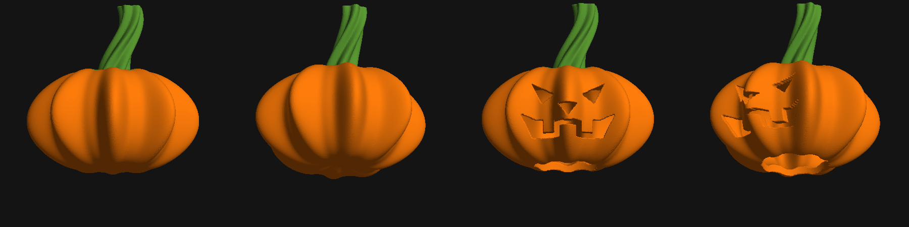

# 3D Comic Pumpkins (50mm STL)

Designed and engineered by **Senior 3D Technical Artist & Computational Geometry Specialist**.

This repository contains two production-ready, watertight (manifold) 3D printable models in standard STL format, measuring strictly **50.0 x 50.0 x 50.0 mm** (5 x 5 x 5 cm bounding envelope):

1. **`comic_pumpkin_50mm.stl`** - Stylized Intact Comic Pumpkin with 8 chunky cartoon lobes, polar calyx depression, and an expressive, fluted curling stem.
2. **`comic_jackolantern_50mm.stl`** - Stylized Carved Jack-o'-Lantern featuring mischievous comic eyes, inverted triangle nose, wide toothy grin, hollow 3mm internal shell, and a bottom port for LED tea-light candles.

---

## Visual Showcase



*(Left to Right: Intact Front, Intact Perspective, Jack-o'-Lantern Front, Jack-o'-Lantern Perspective)*

---

## Technical Specifications

| Parameter | comic_pumpkin_50mm.stl | comic_jackolantern_50mm.stl |
| :--- | :--- | :--- |
| **Bounding Box** | 50.00 x 50.00 x 47.89 mm | 50.00 x 49.83 x 47.82 mm |
| **Mesh Quality** | 100% Watertight (Manifold) | 100% Watertight (Manifold) |
| **Non-Manifold Edges** | 0 | 0 |
| **Boundary Edges** | 0 | 0 |
| **Triangles (Faces)** | 198,856 | 319,892 |
| **Vertices** | 99,430 | 159,940 |
| **Internal Chamber** | Solid (Slicer infill-ready) | Hollow (3.0mm wall shell) |
| **Bottom Port** | Stable flat base | 22.0 mm diameter opening for LED lights |
| **Solid Material Volume** | 30.15 cm3 | 9.95 cm3 |

---

## 3D Printing Recommendations

- **Orientation:** Upright as exported (Z-axis up). Both models feature a stable flat base for build plate adhesion.
- **Layer Height:** 0.12 - 0.20 mm (0.16 mm recommended for smooth cartoon ridges).
- **Supports:** 
  - `comic_pumpkin_50mm.stl`: None needed (self-supporting curves).
  - `comic_jackolantern_50mm.stl`: Optional minimal tree supports for the upper teeth overhangs; however, standard 3mm bridging handles them cleanly on most tuned FDM/SLA printers.
- **Infill:** 
  - Intact pumpkin: 10 - 15% Gyroid or Grid.
  - Jack-o'-Lantern: 100% (already hollowed to 3mm solid wall thickness).
- **Illumination:** The Jack-o'-Lantern features a 22 mm diameter bottom opening designed to fit standard mini LED tea-lights or fairy lights to glow through the eyes and mouth.

---

## Procedural Generation Script

The models are mathematically generated from Signed Distance Fields (SDF) using `numpy`, `scipy`, `scikit-image`, and `trimesh`. To regenerate:

```bash
uv run --with numpy,scipy,scikit-image,trimesh,matplotlib,pillow python3 generate_comic_pumpkins.py
```
